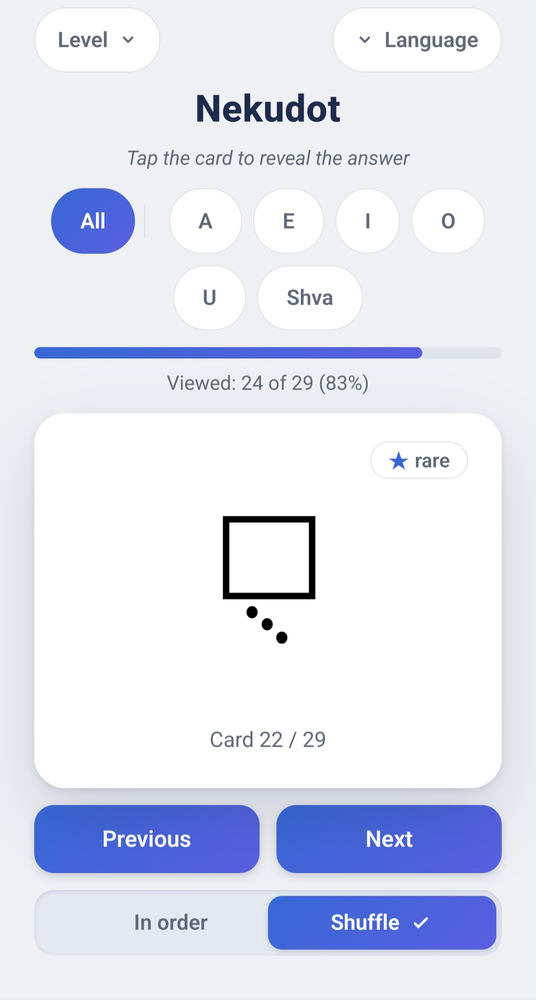
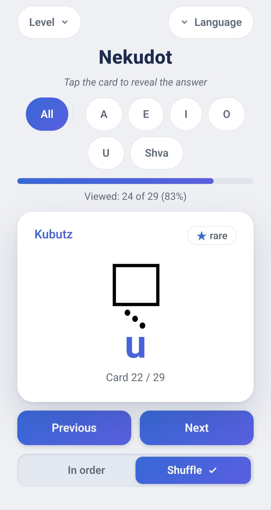
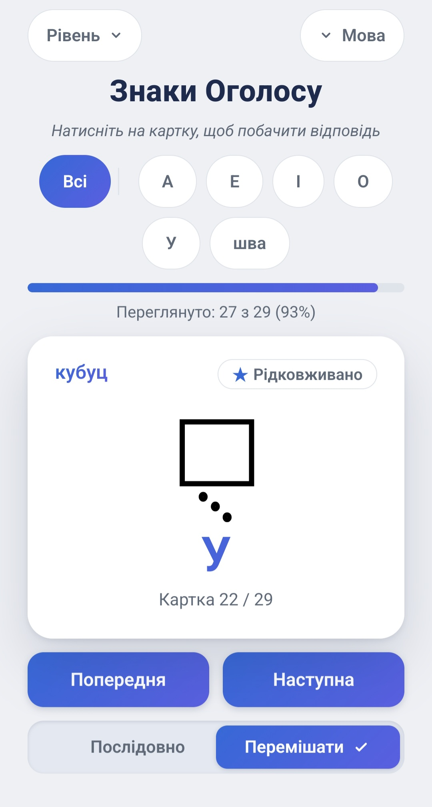

**A multilingual flashcard app for learning Hebrew *nikud* (the vowel points), rebuilt from the ground up — and documented as I built it, decision by decision, with an honest record of what I drove and what I learned.**

**In short:**
- **What:** I rebuilt my own Hebrew vowel-points flashcard app as a trilingual, data-driven web app designed for older, low-vision learners.
- **How:** An AI assistant (Claude, by Anthropic) wrote the code; I owned the architecture and decisions, logged who drove each one (100+ entries), and verified every change on real phones.
- **Result:** 29 cards in three languages, a fifth of the original file size, WCAG AA contrast, and bugs caught that neither the AI nor my own eye spotted at first.
 

  
  
  
  

---

- **Live app:** [oksana-kozii.github.io/hebrew-vowels-trainer](https://oksana-kozii.github.io/hebrew-vowels-trainer/)
- **Source:** [github.com/oksana-kozii/hebrew-vowels-trainer](https://github.com/oksana-kozii/hebrew-vowels-trainer)
- **My role:** sole architect, director, and tester. Built with AI-assisted development — I design and verify, the AI generates code to my direction, and I accept, reject, or overrule.
- **Stack:** vanilla HTML / CSS / JavaScript · data-driven (content read from JSON at runtime) · self-drawn SVG pictograms · GitHub Pages.

## The problem

I’d been studying Hebrew with an old flashcard app I had made (https://github.com/oksana-kozii/hebrew-vowels-trainer/tree/main/archive), but it had three limits. Its interface was Russian-only. Its cards were hard-coded into the program, so I couldn't add or change a card without editing the code. And there was no way to filter by difficulty or study a chosen subset. I wanted to share it with English-speaking friends and my Ukrainian community, grow the deck as I learned, and eventually reuse the same app for other subjects entirely. That called for a rebuild, not a patch.

I set three goals before writing anything: a trilingual interface (English, Ukrainian, Russian); an architecture where the content lives outside the code, so the app can be re-pointed at a new subject; and a design an older learner, often low-vision — the audience I actually had in mind — can read comfortably on a phone. Designing for low vision paid off a second way. I planned the app as a replacement for paper flashcards: always in your pocket and ready for a quick session on the bus or in a queue. The same choices that help a low-vision reader also make the app easy to use on the move: text that meets WCAG AA contrast, large vowel marks, and well-spaced buttons with 46px touch targets that are hard to miss with a thumb.

## Constraints

- **I didn’t read code when I started.** An AI assistant wrote it. I directed the decisions and verified the results by running the app and checking its content, not by reading source.
- **Old hardware:** a macOS version too old for GitHub Desktop, so every commit went through the browser.
- **The users include low-vision learners**, so the vowel mark could never be shrunk to make room for anything else.

## How I worked

I don't write production code by hand. I own the architecture, the decisions, and the verification; the AI generates the code and explains it in plain language; I accept, reject, or overrule. To keep that rigorous I ran three disciplines the whole way:

- **A decision log with provenance.** Every non-obvious decision went into a running log (over a hundred entries by the end), each recording the alternatives I weighed and, crucially, an *Origin* tag for who drove it: *Mine*; *Claude — my steer* (it produced the thing, toward a goal I set); *Claude — I approved* (it proposed a default, I reviewed and accepted); or *Claude — new to me* (it introduced a concept I didn't know). I later learned this is a named industry practice — an Architecture Decision Record. I'd reinvented it because I needed to know, later, exactly what was mine.
- **On-device acceptance testing.** I wrote down what each piece had to do *before* it was built, then verified every change by running the live app on my own Android phone, on 2nd Android phone and on my laptop — not on a description of it working. Several of the hardest bugs only surfaced on a real touchscreen.
- **Small working slices.** Each feature shipped as a working version I could open on my phone, deployed from the first slice onward.

Two rules kept the build disciplined throughout:
- keep every fact as a single source of truth (define it once, in one place);
- don't build for needs I don't yet have.

## Decisions

Here are a handful of decisions from the log, chosen to show range rather than volume.

**1. Separating content from code, then removing duplication.** The old app baked the cards into the program. I redesigned it to be *data-driven*: the app is a fixed shell that reads its content from external JSON files at runtime, so a whole new subject can be swapped in without touching the code. My first data model stored all three languages as three parallel tables — which meant every language-invariant fact (a card's picture, its difficulty level) was written three times. That invites *drift*: change it in two places, miss the third, and the languages silently disagree. So I *normalized* the data: split it so each fact lives exactly once, with a shared card ID joining the pieces back together. Define once, correct everywhere.

**2. Where I overruled the tool.** These are examples of decisions where I went against the AI's recommendation: 

- For the group filter, its reading was that de-selecting every group should leave you with an empty deck. I chose the opposite: an empty selection means "no filter — show everything," the way clearing all filters works on any shopping site. It matches what a user expects, and it needs no special-case code.
- For difficulty, it offered three filter models. I proposed a fourth it hadn't listed — a multi-select union, where you check any levels you want and see the combined set — and after assessing it, it agreed mine was the better fit.

**3. A learning problem that wasn't a design problem.** Drilling the cards got monotonous fast and my attention dropped. My first instinct was cosmetic — add colour and texture for variety. Testing on myself showed the real lever was the *interaction*, not the appearance. The old app used one overloaded tap (tap to reveal, tap again to advance), and a single repeated gesture becomes automatic — *habituation*. Splitting it into two distinct actions — tap the card to reveal, a separate Next button to advance — restored the variety. It was a UX problem, not a UI one, and I only found that by testing the assumption instead of the symptom.

**4. Accessibility aimed at a real user — including what *not* to build.** My audience is older and low-vision: people who see with difficulty and rely on magnification, large text and strong contrast, not blind users. So I made legibility a hard constraint and kept the work measurable. A contrast audit against WCAG AA (4.5:1 for normal text, 3:1 for large text) found three failures, the worst being the revealed answer itself at about 1.8:1, effectively invisible — and that pale colour was my own design choice. All three were fixed and checked on my phone. The smallest text went up, and every tap target is 46px, above the 44px guideline. The app also has baseline screen-reader semantics, because they cost nothing and fix a real bug: without them, a screen reader announced the answer before you asked for it. I checked that baseline in the browser’s accessibility inspector. But I deliberately did not deepen or advertise screen-reader support. I can’t test it with real screen-reader users, and over-promising accessibility to a vulnerable group is worse than an honest baseline. 

**5. Remembering the user's place.** Testing on my phone, I noticed the app forgot my place on every restart. The whole session lived only in memory, which is wiped when the page closes. The app wasn’t forgetting; it had never remembered. I set the goal: resume exactly where I left off, including deck order and Back/Next history.

The fix saves the session to the browser’s local storage and reads it back on startup. Two traps had to be avoided:

- Save the ID, not the position. A position points at the wrong card once the deck changes, so the save stores stable card IDs, the same rule as the data model.
- JSON can’t hold a Set. Converting a Set to text silently empties it, with no error, so filters and progress are saved as arrays.

The restore is all-or-nothing: if any saved ID is gone, it deals a fresh deck instead of loading half-valid data. A schema version means an old save is rejected cleanly if the format changes.

Testing covered both paths. In an automated round-trip, a mid-session state was saved, wiped and restored, and came back byte-for-byte identical. With a card deliberately removed from the data, the restore declined, as designed. I then verified the feature on my phone: the normal path, the edge cases, and a regression check. Proving the failure case on purpose is the difference between “it worked when I tried it” and knowing it works.

## Verification moments

**1. The first error was mine.** Before any code was written, I checked all 17 original cards against the Wikipedia *Niqqud* chart. Two vowel marks I had drawn myself were wrong: I had placed the line in *reduced patach* too low, and the dot in *reduced segol* too far left. My old app had been teaching me those mistakes. That set the rule for the whole project: nothing goes in because it looks right. It goes in because it was checked, against a source or on the device.

**2. An error the eye can't see.** While converting the data, a character-by-character comparison flagged the Russian name of group A: it was a Latin "A", not a Cyrillic "А". The two are *homoglyphs*, identical on screen but different to the computer, so a filter or search on that name would have failed silently. The same pass found two Ukrainian names I'd entered incompletely in my original card data. Both were fixed before any code read the data, and I confirmed the restructured data matched the old version field by field, with nothing lost.

**3. Exploratory testing.** Clicking through filter and shuffle combinations by hand, I found two bugs the AI hadn't flagged and wrote exact steps to reproduce them:
- In shuffle mode, pressing Back after a reshuffle showed a card I had never seen.
- After a reveal, the next card's answer flashed on screen for a split second.

Testing on the phone also caught a layout bug in the AI's code: pictograms were being scaled down twice, rendering at less than half their intended size. All three were fixed and confirmed on the phone.

## Result

- **29 cards** (up from 17), three languages, group and level filters, shuffle, and progress that survives closing the app
- **About 120 KB** across all files, compared with 609 KB for the original single file
- **SVG pictograms 61% smaller** after optimisation (99 KB to 39 KB), with no change to the drawings
- **Accessibility measured, not assumed:** text contrast meets WCAG AA on every background, touch targets are 46px, keyboard use works, and the answer stays hidden from screen readers until revealed
- **Learning to read code** in the later slices, the AI handed me snippets to paste in myself instead of whole files, which meant reading the existing code to find where each change belonged. It’s slow work, but I can now find my way around the codebase and follow what each part does.

## Reflection

**What I took away:**
A few lessons I wrote down to reuse on the next project.

- *"It didn't work" and "it hasn't arrived yet" look identical.* Browsers and content networks cache aggressively; before debugging code that's actually fine, check whether the change even reached the device. The durable fix is cache-busting — put a version on the file's address and bump it on every change. A deployed version number is spent: when I once bumped it without the real file change, the fix was to move on to the next number, never to reuse the old one.
- *"Back" needs a record of where you've been, not arithmetic on a position.* When the collection under you can change between steps (a reshuffle, a re-filter), an index points somewhere unrelated. Keep a history trail instead.
- *Invisible to the eye is not invisible to a screen reader.* Hiding text by making it transparent leaves it fully present to assistive technology. What's shown on screen and what's exposed to a screen reader are two separate things, and they have to be kept in step deliberately.
- *Plan the data up front; put the whole layout on the phone from day one.* The data model I planned at the start barely changed. My layout decisions kept getting reversed instead: how the deck ends, the card’s shape, the screen height. My slices got each feature’s behaviour onto the phone early, but the layout arrived one control at a time, and each new control squeezed the screen. Next time, the first slice shows every control as a placeholder (a walking skeleton), so the layout can be judged before anything works.

**What I'd keep:** 
- Deciding the delegation split between me and an AI-assistant before writing any code, and writing it into the spec, so every AI session started from the same rules.
- Working in slices.
- Keeping the whole process documented: a decision log with who decided what, a Gotchas file, a backlog, and my own notes.
- Checking data against its source before any code reads it. The data structure never changed once the build started.

**What I'd do differently:**
- Commit the test checks to the repository, so the verification is visible and repeatable.
- Define "done" at the start.
- Separate "the AI found this" from "the AI did this at my request" in the log, so the record stays exact. This would add 2 provenance tags to my existing 4.

**What this shows about how I work:** I can direct an AI to build something real, and I don't take its output, or my own, on trust.

